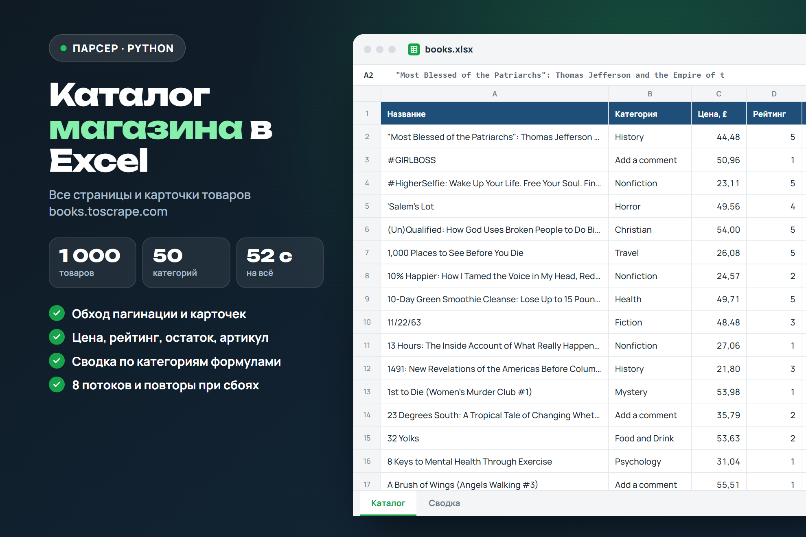
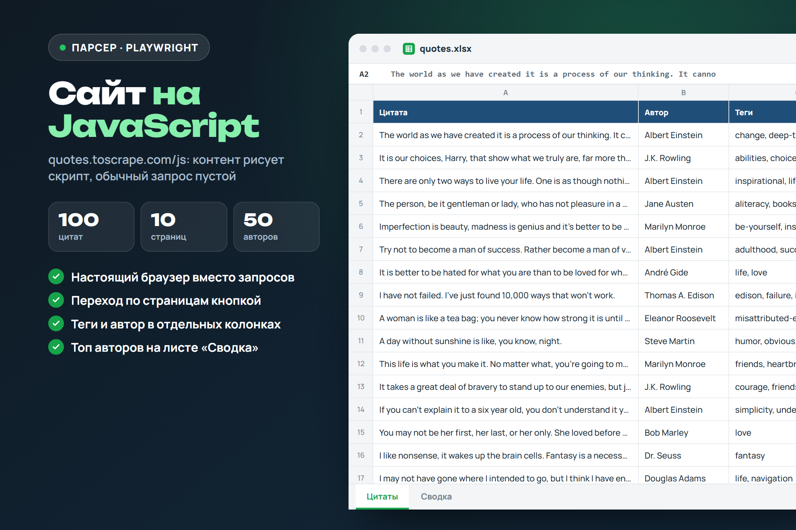
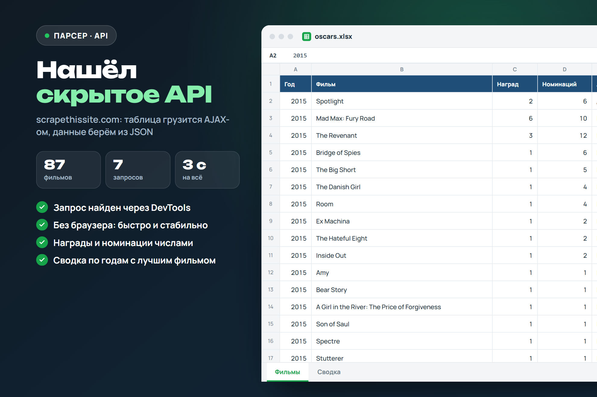
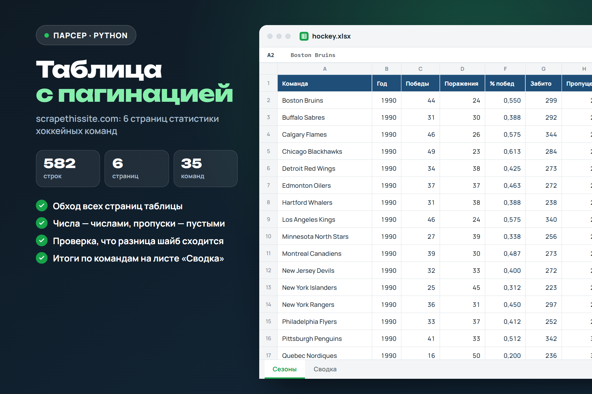

# Парсеры сайтов с выгрузкой в Excel

Четыре парсера на Python для типовых задач: каталог магазина, сайт на JavaScript, данные из скрытого API и таблица с пагинацией. Каждый сохраняет оформленный Excel: заголовки, фильтры, закреплённая шапка, числовые форматы и лист «Сводка» с формулами.

Источники — сайты, созданные специально для практики парсинга ([books.toscrape.com](https://books.toscrape.com), [quotes.toscrape.com](https://quotes.toscrape.com), [scrapethissite.com](https://www.scrapethissite.com)).

| Парсер | Что показывает | Результат |
|---|---|---|
| [`books`](parsers/books.py) | Обход 50 страниц каталога и 1000 карточек товаров в 8 потоков, повторы при сбоях | [books.xlsx](output/books.xlsx): цена, рейтинг, остаток, артикул; сводка по 50 категориям |
| [`quotes_js`](parsers/quotes_js.py) | Сайт рисует контент скриптом: Playwright открывает его в браузере и листает страницы | [quotes.xlsx](output/quotes.xlsx): 100 цитат, авторы, теги; топ авторов |
| [`oscars`](parsers/oscars.py) | Таблица грузится AJAX-ом: запрос найден в DevTools, JSON берём напрямую, без браузера | [oscars.xlsx](output/oscars.xlsx): 87 фильмов 2010–2015; сводка по годам |
| [`hockey`](parsers/hockey.py) | Таблица с пагинацией: 6 страниц, числа приводятся к числам, пропуски остаются пустыми | [hockey.xlsx](output/hockey.xlsx): 582 сезона 35 команд; итоги по командам |



<details>
<summary>Остальные парсеры</summary>





</details>

## Запуск

```bash
python -m venv .venv
.venv/Scripts/pip install -r requirements.txt   # Linux/macOS: .venv/bin/pip
python -m parsers.books        # или quotes_js, oscars, hockey
```

`quotes_js` использует установленный Microsoft Edge (`channel="msedge"`), скачивать браузеры Playwright не нужно. Без Edge: `playwright install chromium` и уберите `channel`.

## Проверка

```bash
python -m tests.check
```

Сверяет выгрузки: количество строк, отсутствие дублей, типы и диапазоны значений, кодировку, связь колонок (разница шайб = забито − пропущено). Формулы листов «Сводка» дополнительно пересчитаны в Excel — ошибок нет.

Картинки в `docs/` нарисованы по первым строкам настоящих выгрузок: `node render/render.cjs`.
